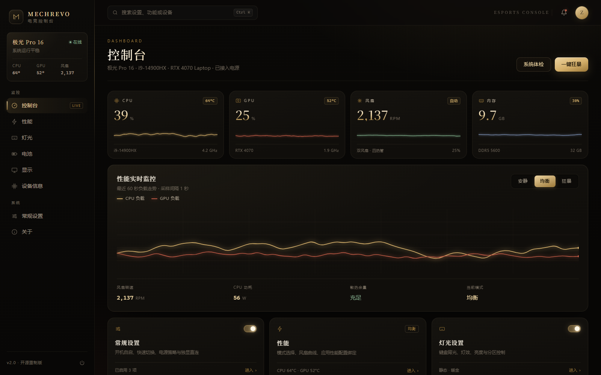
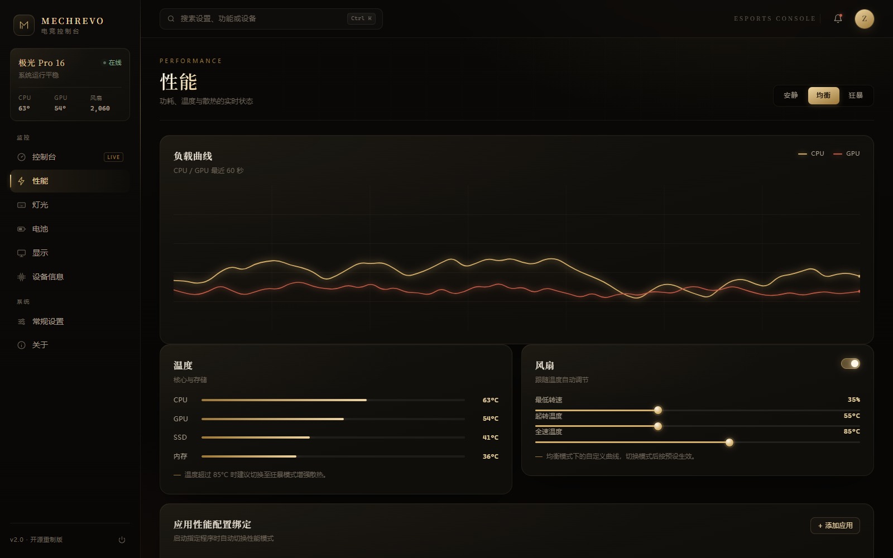
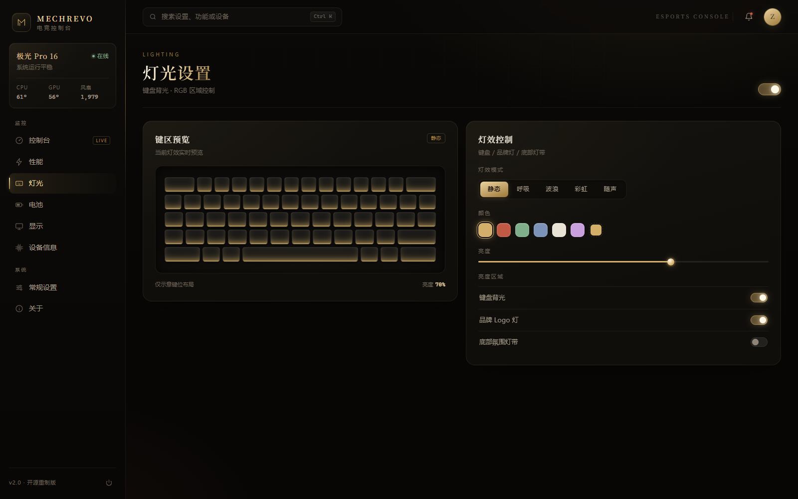
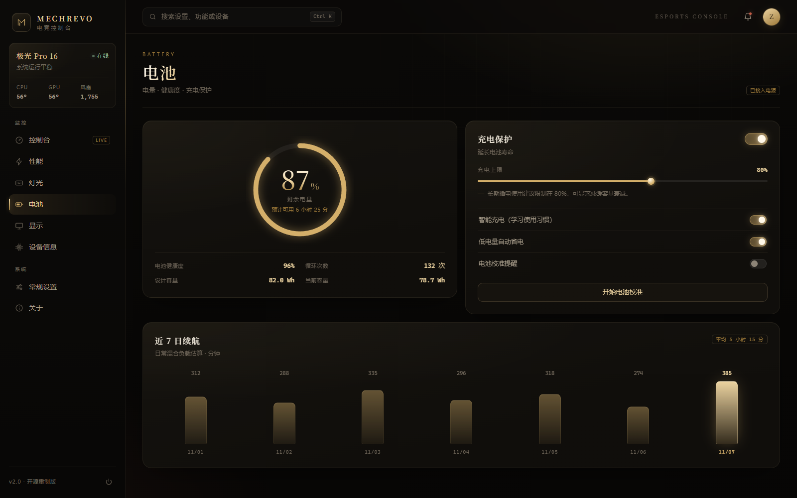

# MECHREVO 电竞控制台 · 暗金重设计

对「机械革命电竞控制台」官方界面的一次高保真重设计概念稿：把原本拥挤、灰白的控制面板，改造成一套**暗色墨金风格**的电竞控制台。

纯前端实现，**零依赖、零构建**，双击 `index.html` 即可打开，不需要联网、不需要安装任何东西。

> ⚠️ 本项目是独立的界面设计稿，与机械革命（MECHREVO）官方无关。界面内所有温度、转速、电量、序列号等数据均为**前端模拟**，不会读写任何硬件。

---

## 预览

**控制台总览** — 实时负载曲线、四大核心指标卡、快捷入口



| 性能 | 灯光 |
|---|---|
|  |  |

**电池** — 电量环、健康度、充电保护、近 7 日续航



其余视图：

| 视图 | 内容 |
|---|---|
| 显示 | 分辨率 / 刷新率 / HDR / 逐通道色彩校正 |
| 设备信息 | 系统信息、实时监控、驱动状态 |
| 常规设置 | 启动行为、快速切换、快捷键说明 |
| 关于 | 版本、更新日志、开源声明 |

## 功能

**控制台**
- CPU / GPU / 风扇 / 内存 四张指标卡，带 60 秒滚动迷你曲线
- 性能实时监控大图（CPU 负载 + GPU 负载双曲线，二次曲线平滑 + 发光）
- 安静 / 均衡 / 狂暴三档模式，切换后遥测基准同步变化
- 系统体检、一键狂暴

**性能**
- 三档性能模式 + 自定义，每档展示功耗墙与风扇策略
- 负载曲线、温度、风扇三块实时图表
- SPC 设置与应用性能配置绑定（增删应用规则）

**灯光**
- 键区预览，支持静态 / 呼吸 / 波浪 / 彩虹 / 随声五种灯效
- 亮度滑杆、分区控制，灯效实时反映在键盘预览上

**电池**
- 电量环 + 预计续航、健康度 / 循环次数 / 设计容量 / 当前容量
- 充电保护（充电上限滑杆、智能充电、低电量自动省电、校准提醒）
- 近 7 日续航柱状图，今日高亮

**显示**
- 分辨率 / 刷新率 / 缩放、HDR、护眼模式
- 色彩模式切换
- 色彩校正：RGB 三通道独立增益 + 标准色板实时预览，可一键恢复默认

**设备信息**
- 基本信息表（处理器、显卡、内存、存储、BIOS、系统版本）
- 实时监控（CPU/GPU 温度、内存占用、磁盘空间）
- 驱动状态（最新 / 可更新标记）
- 一键复制设备信息

**全局**
- 全局搜索：`Ctrl + K` 唤起，命中项金色高亮，`Enter` 跳转，`Esc` 收起
- 侧栏 8 个视图切换，悬停浮起 + 光晕
- 所有开关、滑杆、按钮都有过渡动画与 toast 反馈

## 设计语言

| 元素 | 取值 |
|---|---|
| 墨黑底 | `#070605` |
| 香槟金 | `#d4af6a` |
| 朱砂 | `#c05a45` |
| 青玉 | `#82ab8b` |
| 字体 | 标题衬线 + 正文无衬线 + 数字等宽 |

- 玻璃质感卡片 + 细金线边框
- 径向暖光背景 + 细网格纹理
- 金色渐变标题、悬停浮起与发光
- Canvas 图表 HiDPI 适配、平滑曲线、端点亮斑

## 快速开始

```bash
git clone https://github.com/bietou123/mechrevo-control.git
cd mechrevo-control
```

直接用浏览器打开 `index.html` 即可。

想用本地服务器（可选）：

```bash
python -m http.server 8080
# 访问 http://localhost:8080
```

## 文件结构

```
mechrevo-control/
├── index.html        # 页面结构与文案
├── style.css         # 全部视觉样式与动画
├── app.js            # 视图切换、搜索、图表、模拟遥测
├── docs/preview/     # README 预览截图
├── LICENSE
└── README.md
```

## 快捷键

| 按键 | 作用 |
|---|---|
| `Ctrl + K` | 聚焦搜索框 |
| `Enter` | 跳转到第一个搜索结果 |
| `Esc` | 清空搜索 / 收起 |

## 技术说明

- 原生 HTML + CSS + JavaScript，无任何第三方运行时依赖
- 图表为手写 Canvas 绘制，支持 DPR ≤ 2 的高清渲染
- 遥测数据由模式基准 + 随机游走模拟生成：温度跟随负载、风扇跟随温度、功耗跟随 CPU
- 响应式：≤ 860px 切换为单列布局，≤ 520px 适配手机

## 许可

[MIT](LICENSE)
