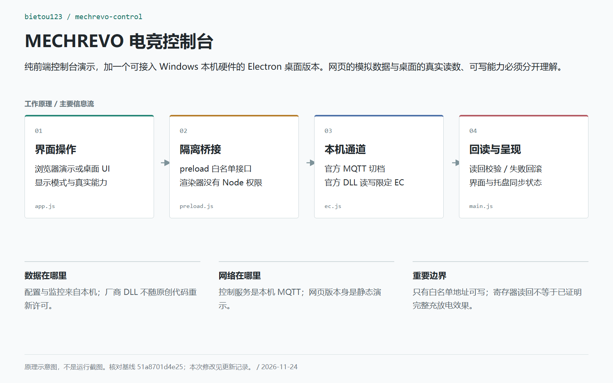
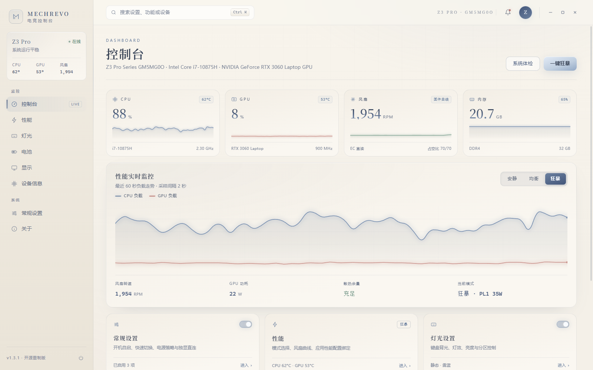

# MECHREVO 电竞控制台

纯前端控制台演示，加一个可接入 Windows 本机硬件的 Electron 桌面版本。网页的模拟数据与桌面的真实读数、可写能力必须分开理解。

**适合谁：** 想了解监控界面重设计与厂商本地接口集成的使用者；硬件操作只适用于已确认匹配的环境。

## 一图看懂

上图是依据公开源码绘制的原理示意，不是运行截图；以下表格与文字提供相同信息，便于小屏阅读。

## 现有实际画面

现有界面截图；网页版与真实桌面能力按正文区分。截图不代表本次新增硬件或平台验收。

## 主链路与源码

| 步骤 | 做了什么 | 代码或说明入口 |
| --- | --- | --- |
| 1. 界面操作 | 浏览器演示或桌面 UI；显示模式与真实能力 | [app.js](../app.js) |
| 2. 隔离桥接 | preload 白名单接口；渲染器没有 Node 权限 | [preload.js](../preload.js) |
| 3. 本机通道 | 官方 MQTT 切档；官方 DLL 读写限定 EC | [ec.js](../ec.js) |
| 4. 回读与呈现 | 读回校验 / 失败回滚；界面与托盘同步状态 | [main.js](../main.js) |

## 关键原理

### 同一页面有两种数据来源

页面根据是否存在 desktop 桥选择实际硬件数据或网页模拟数据。浏览器直接打开不会真的切换机器档位；桌面能力以官方接口与支持表为准，不能由动画、按钮和成功提示证明。

对应入口：[app.js](../app.js)。

### 控制通道必须受限

MQTT 与 EC 是两条不同通道：性能档通过厂商本机服务切换，背光与充电阈值只写批准的 EC 地址。EC 封装先读取原值，再写入并回读，不一致时还原；不开放任意寄存器写入。

对应入口：[ec.js](../ec.js)。

### 没有硬件能力就显示不可用

preload 只暴露受控接口，主进程处理系统托盘和快捷键。官方服务、DLL 或相应硬件不存在时降级为不可用或只读，不替换驱动，也不刷写 EC 固件。

对应入口：[mqtt.js](../mqtt.js)。

## 数据与安全边界

| 范围 | 说明 |
| --- | --- |
| 数据 | 配置与监控来自本机；厂商 DLL 不随原创代码重新许可。 |
| 网络 | 控制服务是本机 MQTT；网页版本身是静态演示。 |
| 重要边界 | 只有白名单地址可写；寄存器读回不等于已证明完整充放电效果。 |

## 运行与复现

浏览器直接打开 index.html 可看演示；真实桌面运行和依赖安装按主 README 的桌面版步骤进行。

本次为图文原理整理，没有执行设备动作、系统切换或付费请求。已有验收范围与运行条件以主 README 和相关报告为准。

## 已知限制

- 机型和厂商服务的差异很大，不能把一台机器的寄存器映射套到其他机器。
- 自定义风扇曲线、RGB 分区等缺少真实通道的能力仍不可用。

## 本次更新

2026-11-24：新增项目专属原理图、源码入口、运行条件与边界说明。本项目本轮没有修改功能，也没有扩大既有实测结论。

## 可编辑流程图

下面的 Mermaid 与上方 PNG 表达同一主链路，便于后续维护：

[返回项目 README](../README.md)

源码核对基线：[51a8701d4e25](https://github.com/bietou123/mechrevo-control/tree/51a8701d4e2577a74e8ddae6e670ef55cf83b234)，并结合本次更新中列明的改动。
